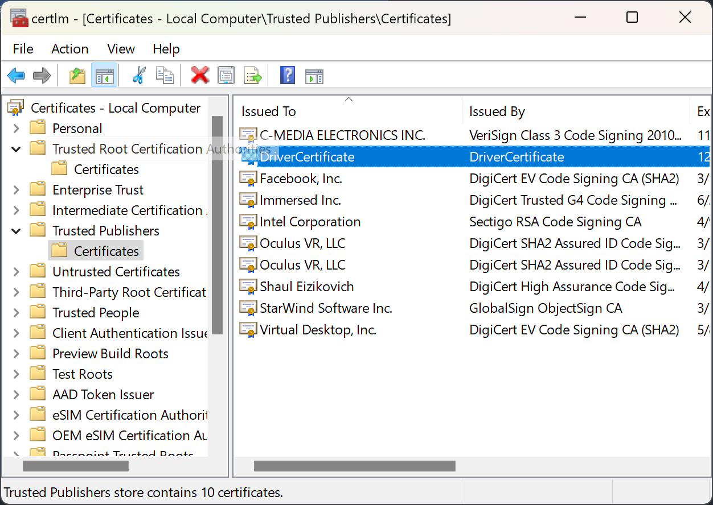
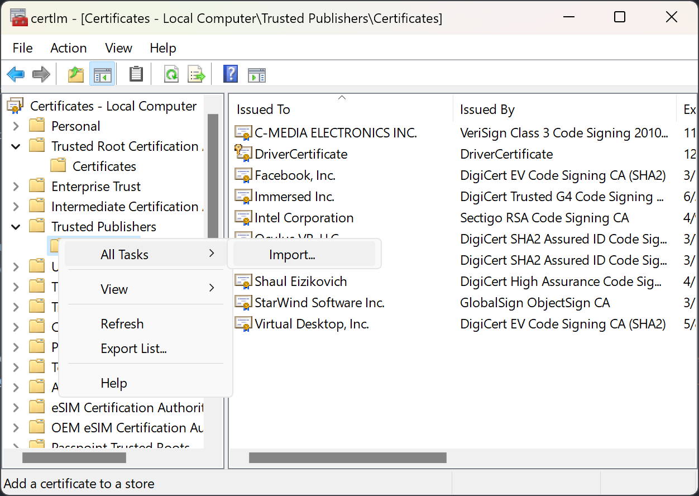

# Verto Display Driver

[](https://github.com/rohitsangwan01/verto-display-driver/releases)

Maintained by [VertoXR](https://vertoxr.com/)

This is a Windows driver made in Rust which creates a virtual desktop.

It has many uses, such as:
- A private virtual desktop for VR use
- For remote desktops
- For screenshare presentations, to give you more workspace with a second monitor
- Getting a higher resolution (or higher refresh rate) display when you don't have a physical one on-hand (though note you can only use it in software/VR)
- Other uses? Let me know!

Supports: Windows 10 2004+, Windows 11 (x64 and ARM64)

## Features
- Multiple monitors (up to 10)
- Multiple resolutions per monitor
- Multiple refresh rates per resolution

## How to install
1. Go to the [releases](https://github.com/rohitsangwan01/verto-display-driver/releases) section for the latest driver.
2. Download (you may receive a warning, just press accept)
3. [Install certificate](#installing-the-certificate)
4. Run the msi installer
5. The driver will be installed, started, and you can find a shortcut to the control app in the start menu, named "Virtual Display Driver Control"

_Note: For users having trouble installing/running the app, please see [issues](https://github.com/rohitsangwan01/verto-display-driver/issues)_

## How to install portable version
1. Go to the [releases](https://github.com/rohitsangwan01/verto-display-driver/releases) section for the latest driver.
2. Download (you may receive a warning, just press accept)
3. [Install certificate](#installing-the-certificate)
4. Install `install.reg`
5. Open device manager
   * click on any item in the list
   * go to `Actions -> Add legacy hardware`
   * next on `Install hardware that I manually select from a list`
   * next on `Show all devices
   * click on `Have Disk...` and select the folder with the driver files in it
   * finish the setup
7. The driver will be installed and started. The control panel exe you see in the folder will work from anywhere you put it.

### Optional: Installing the driver with `nefcon` CLI

0. You might need to install the driver certificate and/or `install.reg`
1. Get `nefconc` CLI
  - Download the [official latest release](https://github.com/nefarius/nefcon/releases/latest)
  - Or from our repo: [installer/nefconc.exe](./installer/files/nefconc.exe)
2. Put `nefconc.exe` in the extracted portable folder
3. Open console on this folder and run:

```
.\nefconc.exe --remove-device-node --hardware-id Root\VirtualDisplayDriver --class-guid "4D36E968-E325-11CE-BFC1-08002BE10318"
.\nefconc.exe --create-device-node --class-name Display --class-guid "4D36E968-E325-11CE-BFC1-08002BE10318" --hardware-id Root\VirtualDisplayDriver
.\nefconc.exe --install-driver --inf-path ".\VirtualDisplayDriver.inf"
```
You can also completely uninstall the driver only by executing the first command:
```
.\nefconc.exe --remove-device-node --hardware-id Root\VirtualDisplayDriver --class-guid "4D36E968-E325-11CE-BFC1-08002BE10318"
```

## Installing the certificate
The certificate needs installation for Windows to accept the driver
1. In your downloaded zip, there is a file `DriverCertificate.cer` and `install-cert.bat`
2. Open a cmd prompt as admin and run `install-cert.bat`
3. Verify the certificate installed properly. *

\* If the certificate didn't install properly, then the driver won't install. If driver installation fails, this is most likely the reason why; and you should check that the certificate is actually installed. Try manually running the commands in the [`install-cert.bat` file](./installer/install-cert.bat) (below) in an admin cmd prompt to make sure the certificate is installed correctly (for both root and TrustedPublisher stores). The commands will tell you if they successfully added it or not.
```
certutil -addstore -f root "DriverCertificate.cer"
certutil -addstore -f TrustedPublisher "DriverCertificate.cer"
```
You can also search for `Manage Computer Certificates`, look in `Trusted Publishers` and `Trusted Root Certification`, you will see the certificate named `DriverCertficate`.



You can manually import it by right clicking on the menu entry -> `All Tasks` -> `Import`, and following the instructions in the import wizard



Why is it so difficult? The reason I didn't add auto certificate installation is because I believe certificates are a personal thing, and should not be added automatically without the users knowledge.

## Windows ARM64 Support & Installation

This project natively supports Windows 11 on **ARM64** (including Snapdragon X Elite / Plus, Surface Pro ARM64, and Windows on ARM virtual machines) alongside **x64**.

### Driver Signature & Test Signing (Required for ARM64 & Test Builds)
Because this driver is self-signed using a local certificate (rather than a Microsoft WHQL-issued certificate), Windows requires either enabling **Test Signing** mode or **disabling Driver Signature Enforcement** to allow the driver to load.

> **Note on Secure Boot:**
> If **Secure Boot** is enabled in your UEFI/BIOS settings, Windows will block turning on Test Signing. You must disable Secure Boot in your device's UEFI/BIOS settings before enabling test signing.

#### Option A: Enable Test Signing Mode (Recommended)
1. Open PowerShell or Command Prompt as **Administrator**.
2. Enable test signing by running:
   ```cmd
   bcdedit /set testsigning on
   ```
3. Restart your computer. Windows will boot into Test Mode (indicated by a small "Test Mode" watermark in the lower-right corner of the desktop).
4. Install the certificate: run `install-cert.bat` as Administrator (or follow the [certificate installation instructions](#installing-the-certificate)).
5. Install the driver: run `installer\install-driver.bat` or `installer\install-driver.ps1` as Administrator.
   - The script automatically detects the `ARM64` architecture, utilizes the ARM64 `nefconc.exe` tool, imports registry settings, creates the device node, and installs the driver package.

*(To disable test signing later, run `bcdedit /set testsigning off` from an elevated prompt and reboot).*

#### Option B: Temporarily Disable Driver Signature Enforcement
If you prefer not to keep permanent Test Mode enabled:
1. Hold the `Shift` key while clicking **Restart** in the Windows Start menu (or navigate to `Settings` -> `System` -> `Recovery` -> `Advanced startup` -> `Restart now`).
2. Go to **Troubleshoot** -> **Advanced options** -> **Startup Settings** -> **Restart**.
3. Upon restart, press `7` or `F7` to select **Disable driver signature enforcement**.
4. Once booted into Windows, install the certificate and run `installer\install-driver.bat` as Administrator.

## Updating
1. Download the new release
2. Install the msi package

## How to build
1. Download and install [Visual Studio](https://visualstudio.microsoft.com/downloads/) (use the 2022 edition)
   - Select and install the `Desktop development with C++` workload as well as Windows SDK
2. Install the [WDK](https://learn.microsoft.com/en-us/windows-hardware/drivers/download-the-wdk)
3. Install [`cargo-make`](https://github.com/sagiegurari/cargo-make) if you don't have it
4. Install [`cargo-target-dir`](https://github.com/MolotovCherry/cargo-target-dir)

Make sure you generate your own windows code signing cert and install it according to "Installing the certificate" section.

You can build it with `cargo make build` (debug) or `cargo make -p prod build` (release), and check the `target/output` directory for all the files

To build the installer, do a `cargo make build-installer` (dev) or `cargo make -p prod build-installer` (release). In order to build the installer, you need [wix toolset](https://github.com/wixtoolset/wix3/releases) installed and on `Path`

... Or, fork my project and build it with github actions. You will require 2 repository secrets:
* `PRIVATE_KEY` - a windows code signing pfx certificate encoded in base64 (use `certutil -encode`)
* `PRIVATE_KEY_PASSWORD` - self explanatory

### Debugging or Reporting Crashes
If you want to debug a problem or need to report a crash, follow the below instructions:

All messages from the driver are logged in the Windows Event Viewer.
1. Open the Event Viewer
3. Go to `Windows Logs` -> `Application`
4. You will see logs for the driver under the source name `VirtualDisplayDriver`

If you want to make them easier to see
1. right click on `Custom Views`
   - click `Create Custom View...`
     - select `By source`
     - find and select `VirtualDisplayDriver` in the list, then press `Ok`
     - type in `VirtualDisplayDriver` for the name, and press `Ok`
2. You should now see any log messages under the `Custom Views` section for `VirtualDisplayDriver`

If you're using a driver compiled in debug mode, you can see panic messages and other information in a live logger: download [DebugViewPP](https://github.com/CobaltFusion/DebugViewPP), run it, click on `Log`->`Capture Global Win32` (note, this requires DebugViewPP be run with admin permissions). As long as the program is open and capturing, the messages will appear live as they are logged. This is a bit easier to use than the event log when you are trying to debug something.

## Contributions
All contributions are welcome!

For first time contributors, please read our [contributing](CONTRIBUTING.md) guide.

## Upstream & Fork Notice

This project is a fork of [virtual_display_rs](https://github.com/MolotovCherry/virtual-display-rs) originally created by [MolotovCherry](https://github.com/MolotovCherry).

Special thanks and credit go to MolotovCherry and upstream contributors for the original implementation of the Rust-based Windows Indirect Display Driver. Maintained as part of the [VertoXR](https://vertoxr.com/) project, this fork adds and maintains native support for Windows ARM64 (`aarch64-pc-windows-msvc`), multi-architecture build pipelines, and automated installation scripts.


